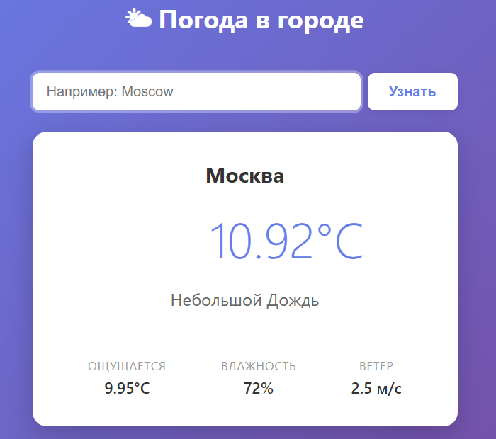

# Приложение с погодой

Можно узнать погоду по всему миру. Просто введите название города на русском или английском языке.

## Скриншот



## Возможности

- Поиск погоды по названию города (русский / английский)
- Температура и «ощущается как»
- Описание погоды (ясно, пасмурно, дождь)
- Влажность и скорость ветра
- Иконка текущей погоды
- Обработка ошибок: город не найден, API недоступен

## Стек

- **Python 3.12.5**
- **Flask 3.1.3** — веб-фреймворк
- **requests 2.34.2** — HTTP-запросы к API
- **python-dotenv 1.2.4** — загрузка переменных окружения
- **OpenWeatherMap API** — источник данных о погоде

## Запуск

### 1. Клонировать репозиторий

```bash
git clone https://github.com/ZaurRomanoV/weather-app.git
```

### 2. Создать виртуальное окружение

```bash
python -m venv venv
```

Активировать:

- **Windows:** `venv\Scripts\activate`
- **Mac/Linux:** `source venv/bin/activate`

### 3. Установить зависимости

```bash
pip install -r requirements.txt
```

### 4. Получить API-ключ

Зарегистрируйтесь на [openweathermap.org](https://openweathermap.org), получите бесплатный API-ключ и создайте файл `.env` в корне проекта:

```
OPENWEATHER_API_KEY=ваш_ключ_здесь
```

### 5. Запустить приложение

```bash
python app.py
```

Откройте http://127.0.0.1:5000 в браузере.

## Использование

1. Введите название города в поле поиска.
2. Нажмите «Узнать».
3. Приложение покажет текущую погоду в этом городе.

**Примеры городов:** `Moscow`, `London`, `Tokyo`, `Москва`, `Лондон`.

## Структура

```
weather-app/
├── static/
│   └── style.css           #  Стили
├── templates/
│   └── index.html          #  Главная страница
├── app.py                  #  Основной код приложения
├── .env                    #  API-ключ (не в git)
├── .gitignore              #  Исключения для git
├── requirements.txt
├── screenshot.png          #  Скриншот приложения
└── README.md
```

## Автор

**Романов Заур**
- GitHub: [@ZaurRomanoV](https://github.com/ZaurRomanoV)
- Email: zaur.romanov.06@mail.ru